<!--  -->

<svg width="905.054" height="117.334" viewBox="0 0 905.054 117.334" xmlns="http://www.w3.org/2000/svg">
	<g id="svgGroup" stroke-linecap="round" fill-rule="evenodd" font-size="9pt" stroke="#000" stroke-width="0.25mm" fill="none" style="stroke:#000;stroke-width:0.25mm;fill:none">
		<path d="M 68.775 70.313 L 68.775 111.768 Q 68.775 113.159 68.006 114.148 A 2.328 2.328 0 0 1 66.951 114.897 Q 66.307 115.137 65.406 115.137 L 54.42 115.137 Q 53.248 115.137 52.332 114.807 A 3.466 3.466 0 0 1 51.397 114.286 Q 51.049 114.019 50.718 113.649 A 6.198 6.198 0 0 1 50.611 113.525 L 46.07 107.666 L 45.557 107.666 Q 42.188 112.573 36.512 114.771 A 31.73 31.73 0 0 1 29.581 116.547 A 42.914 42.914 0 0 1 23.438 116.968 A 31.083 31.083 0 0 1 16.272 116.187 A 21.146 21.146 0 0 1 6.336 110.925 A 19.906 19.906 0 0 1 0.589 100.309 A 29.506 29.506 0 0 1 0.001 94.263 Q 0.001 88.77 2.015 84.045 A 18.107 18.107 0 0 1 5.675 78.601 A 24.73 24.73 0 0 1 9.046 75.696 Q 12.691 73.062 18.463 71.181 A 63.122 63.122 0 0 1 23.108 69.873 Q 32.154 67.676 46.216 67.31 A 21.026 21.026 0 0 0 45.953 63.856 Q 45.279 59.821 42.884 57.715 A 10.467 10.467 0 0 0 39.33 55.712 Q 36.635 54.785 32.886 54.785 Q 26.88 54.785 23.072 56.836 A 156.368 156.368 0 0 0 21.744 57.559 Q 19.739 58.663 18.806 59.274 A 8.138 8.138 0 0 0 18.311 59.619 Q 17.324 60.465 15.93 60.293 A 4.2 4.2 0 0 1 15.821 60.278 A 23.052 23.052 0 0 1 13.515 59.81 A 29.421 29.421 0 0 1 11.609 59.253 A 117.356 117.356 0 0 1 9.293 58.466 A 147.197 147.197 0 0 1 6.812 57.568 A 2.688 2.688 0 0 1 6.502 57.419 Q 6.356 57.337 6.198 57.23 A 5.306 5.306 0 0 1 6.006 57.092 A 1.236 1.236 0 0 1 5.569 56.466 A 1.828 1.828 0 0 1 5.494 56.104 A 4.741 4.741 0 0 1 5.503 55.817 Q 5.512 55.678 5.528 55.521 A 10.696 10.696 0 0 1 5.567 55.188 Q 5.627 54.737 5.835 53.67 A 104.295 104.295 0 0 1 5.933 53.174 A 38.17 38.17 0 0 1 6.182 52.031 Q 6.437 50.933 6.812 49.548 A 45.034 45.034 0 0 1 7.1 48.53 Q 7.426 47.431 7.728 46.658 A 11.98 11.98 0 0 1 7.911 46.216 Q 8.57 44.971 10.108 43.872 A 5.188 5.188 0 0 1 10.858 43.384 Q 12.233 42.618 15.396 41.411 A 130.604 130.604 0 0 1 17.652 40.576 A 30.244 30.244 0 0 1 22.139 39.379 Q 27.682 38.306 35.889 38.306 A 48.842 48.842 0 0 1 48.703 39.837 Q 63.365 43.833 67.317 58.252 A 45.691 45.691 0 0 1 68.775 70.312 Z M 46.07 89.429 L 46.07 81.299 Q 35.889 81.299 30.799 82.874 Q 26.265 84.276 24.433 86.434 A 5.853 5.853 0 0 0 24.024 86.975 A 9.649 9.649 0 0 0 22.339 92.432 Q 22.339 96.68 24.976 98.328 Q 27.613 99.976 31.495 99.976 Q 38.233 99.976 41.675 96.533 Q 44.692 93.517 45.796 90.332 A 11.885 11.885 0 0 0 46.07 89.429 Z" id="0" vector-effect="non-scaling-stroke"/>
		<path d="M 113.453 109.644 L 98.145 116.675 A 17.068 17.068 0 0 1 97.472 116.948 Q 96.514 117.311 96.011 117.333 A 1.445 1.445 0 0 1 95.948 117.334 Q 95.289 117.334 94.556 116.821 A 5.219 5.219 0 0 1 93.635 115.967 Q 92.302 114.442 90.711 111.072 A 17.474 17.474 0 0 1 89.583 107.776 Q 88.742 104.339 88.586 99.334 A 75.818 75.818 0 0 1 88.55 96.973 L 88.55 12.158 Q 88.55 10.986 88.876 10.172 A 3.018 3.018 0 0 1 89.283 9.448 A 35.135 35.135 0 0 1 91.992 6.334 Q 93.45 4.831 95.261 3.247 A 78.741 78.741 0 0 1 98.292 0.732 A 5.429 5.429 0 0 1 98.896 0.354 Q 99.562 0 100.123 0 A 2.574 2.574 0 0 1 101.369 0.331 A 3.629 3.629 0 0 1 101.954 0.732 Q 105.103 3.149 107.264 5.273 A 41.655 41.655 0 0 1 109.469 7.607 A 32.395 32.395 0 0 1 110.962 9.448 Q 111.534 10.191 111.66 11.425 A 7.251 7.251 0 0 1 111.695 12.158 L 111.695 92.505 A 48.946 48.946 0 0 0 111.808 95.93 Q 111.997 98.616 112.501 100.745 Q 113.306 104.15 114.405 106.201 A 5.047 5.047 0 0 1 114.657 106.768 Q 115.242 108.36 114.101 109.254 A 3.333 3.333 0 0 1 113.453 109.644 Z" id="1" vector-effect="non-scaling-stroke"/>
		<path d="M 196.509 70.313 L 196.509 111.768 Q 196.509 113.159 195.74 114.148 A 2.328 2.328 0 0 1 194.685 114.897 Q 194.041 115.137 193.14 115.137 L 182.154 115.137 Q 180.982 115.137 180.066 114.807 A 3.466 3.466 0 0 1 179.131 114.286 Q 178.783 114.019 178.453 113.649 A 6.198 6.198 0 0 1 178.345 113.525 L 173.804 107.666 L 173.292 107.666 Q 169.922 112.573 164.246 114.771 A 31.73 31.73 0 0 1 157.316 116.547 A 42.914 42.914 0 0 1 151.172 116.968 A 31.083 31.083 0 0 1 144.006 116.187 A 21.146 21.146 0 0 1 134.07 110.925 A 19.906 19.906 0 0 1 128.323 100.309 A 29.506 29.506 0 0 1 127.735 94.263 Q 127.735 88.77 129.749 84.045 A 18.107 18.107 0 0 1 133.409 78.601 A 24.73 24.73 0 0 1 136.78 75.696 Q 140.426 73.062 146.197 71.181 A 63.122 63.122 0 0 1 150.843 69.873 Q 159.888 67.676 173.951 67.31 A 21.026 21.026 0 0 0 173.687 63.856 Q 173.013 59.821 170.618 57.715 A 10.467 10.467 0 0 0 167.064 55.712 Q 164.37 54.785 160.621 54.785 Q 154.615 54.785 150.806 56.836 A 156.368 156.368 0 0 0 149.478 57.559 Q 147.474 58.663 146.54 59.274 A 8.138 8.138 0 0 0 146.045 59.619 Q 145.059 60.465 143.664 60.293 A 4.2 4.2 0 0 1 143.555 60.278 A 23.052 23.052 0 0 1 141.249 59.81 A 29.421 29.421 0 0 1 139.344 59.253 A 117.356 117.356 0 0 1 137.028 58.466 A 147.197 147.197 0 0 1 134.546 57.568 A 2.688 2.688 0 0 1 134.237 57.419 Q 134.09 57.337 133.933 57.23 A 5.306 5.306 0 0 1 133.741 57.092 A 1.236 1.236 0 0 1 133.304 56.466 A 1.828 1.828 0 0 1 133.228 56.104 A 4.741 4.741 0 0 1 133.238 55.817 Q 133.246 55.678 133.262 55.521 A 10.696 10.696 0 0 1 133.301 55.188 Q 133.361 54.737 133.569 53.67 A 104.295 104.295 0 0 1 133.668 53.174 A 38.17 38.17 0 0 1 133.916 52.031 Q 134.171 50.933 134.546 49.548 A 45.034 45.034 0 0 1 134.835 48.53 Q 135.161 47.431 135.463 46.658 A 11.98 11.98 0 0 1 135.645 46.216 Q 136.304 44.971 137.842 43.872 A 5.188 5.188 0 0 1 138.593 43.384 Q 139.967 42.618 143.131 41.411 A 130.604 130.604 0 0 1 145.386 40.576 A 30.244 30.244 0 0 1 149.874 39.379 Q 155.416 38.306 163.624 38.306 A 48.842 48.842 0 0 1 176.437 39.837 Q 191.099 43.833 195.051 58.252 A 45.691 45.691 0 0 1 196.509 70.312 Z M 173.804 89.429 L 173.804 81.299 Q 163.624 81.299 158.533 82.874 Q 153.999 84.276 152.167 86.434 A 5.853 5.853 0 0 0 151.758 86.975 A 9.649 9.649 0 0 0 150.074 92.432 Q 150.074 96.68 152.711 98.328 Q 155.347 99.976 159.229 99.976 Q 165.967 99.976 169.41 96.533 Q 172.426 93.517 173.53 90.332 A 11.885 11.885 0 0 0 173.804 89.429 Z" id="2" vector-effect="non-scaling-stroke"/>
		<path d="M 335.45 68.481 L 335.45 111.255 Q 335.45 113.161 334.761 114.047 A 2.015 2.015 0 0 1 334.534 114.294 A 2.606 2.606 0 0 1 333.711 114.791 Q 332.95 115.089 331.797 115.13 A 10.612 10.612 0 0 1 331.421 115.137 L 316.334 115.137 Q 314.424 115.137 313.482 114.5 A 2.228 2.228 0 0 1 313.221 114.294 A 2.335 2.335 0 0 1 312.663 113.472 Q 312.305 112.628 312.305 111.255 L 312.305 72.29 A 35.557 35.557 0 0 0 312.093 68.26 Q 311.602 63.972 309.974 61.445 A 8.752 8.752 0 0 0 309.302 60.535 Q 306.441 57.15 300.854 56.99 A 19.604 19.604 0 0 0 300.294 56.982 A 19.44 19.44 0 0 0 296.9 57.261 Q 295.017 57.595 293.512 58.33 A 9.928 9.928 0 0 0 291.834 59.363 A 12.674 12.674 0 0 0 287.689 64.97 A 15.639 15.639 0 0 0 287.403 65.771 L 287.403 111.255 Q 287.403 113.161 286.714 114.047 A 2.015 2.015 0 0 1 286.487 114.294 A 2.606 2.606 0 0 1 285.664 114.791 Q 284.903 115.089 283.75 115.13 A 10.612 10.612 0 0 1 283.375 115.137 L 268.287 115.137 Q 266.377 115.137 265.436 114.5 A 2.228 2.228 0 0 1 265.174 114.294 A 2.335 2.335 0 0 1 264.616 113.472 Q 264.258 112.628 264.258 111.255 L 264.258 72.29 A 30.668 30.668 0 0 0 263.998 68.141 Q 263.349 63.407 261.088 60.787 A 9.147 9.147 0 0 0 260.962 60.645 Q 257.667 56.982 252.32 56.982 A 16.732 16.732 0 0 0 248.943 57.304 Q 246.161 57.877 244.19 59.473 A 16.596 16.596 0 0 0 239.43 65.771 L 239.429 65.771 L 239.429 111.255 Q 239.429 113.161 238.74 114.047 A 2.015 2.015 0 0 1 238.514 114.294 A 2.606 2.606 0 0 1 237.69 114.791 Q 236.929 115.089 235.776 115.13 A 10.612 10.612 0 0 1 235.401 115.137 L 220.313 115.137 Q 218.403 115.137 217.462 114.5 A 2.228 2.228 0 0 1 217.2 114.294 A 2.335 2.335 0 0 1 216.642 113.472 Q 216.285 112.628 216.285 111.255 L 216.285 49.878 Q 216.285 48.705 216.611 47.891 A 3.018 3.018 0 0 1 217.017 47.168 A 33.369 33.369 0 0 1 218.944 44.838 A 42.889 42.889 0 0 1 220.716 42.993 A 45.934 45.934 0 0 1 222.796 41.079 Q 224.254 39.812 226.026 38.452 Q 226.737 37.905 227.408 37.767 A 2.218 2.218 0 0 1 227.857 37.72 A 2.17 2.17 0 0 1 228.52 37.831 Q 229.063 38.006 229.688 38.452 A 71.01 71.01 0 0 1 232.379 40.67 Q 233.617 41.745 234.666 42.774 A 42.474 42.474 0 0 1 234.961 43.066 A 37.619 37.619 0 0 1 238.194 46.734 A 33.806 33.806 0 0 1 238.843 47.607 L 239.21 47.607 A 18.379 18.379 0 0 1 241.469 45.256 Q 243.677 43.304 246.973 41.382 A 19.118 19.118 0 0 1 251.458 39.538 Q 255.85 38.306 262.061 38.306 A 49.85 49.85 0 0 1 266.952 38.529 Q 271.858 39.014 274.953 40.556 A 12.532 12.532 0 0 1 275.977 41.125 A 27.858 27.858 0 0 1 280.995 45.065 A 24.026 24.026 0 0 1 283.375 47.827 A 19.155 19.155 0 0 1 285.824 45.381 Q 287.168 44.246 288.878 43.134 A 44.916 44.916 0 0 1 291.761 41.418 Q 297.409 38.321 307.662 38.306 A 68.369 68.369 0 0 1 307.764 38.306 Q 322.413 38.306 328.931 45.85 Q 335.45 53.394 335.45 68.481 Z" id="3" vector-effect="non-scaling-stroke"/>
		<path d="M 378.37 44.019 L 378.37 111.255 Q 378.37 113.161 377.681 114.047 A 2.015 2.015 0 0 1 377.454 114.294 A 2.606 2.606 0 0 1 376.631 114.791 Q 375.87 115.089 374.716 115.13 A 10.612 10.612 0 0 1 374.341 115.137 L 359.253 115.137 Q 357.344 115.137 356.402 114.5 A 2.228 2.228 0 0 1 356.141 114.294 A 2.335 2.335 0 0 1 355.583 113.472 Q 355.225 112.628 355.225 111.255 L 355.225 44.019 Q 355.225 42.112 355.914 41.226 A 2.015 2.015 0 0 1 356.141 40.979 A 2.606 2.606 0 0 1 356.964 40.482 Q 357.725 40.184 358.878 40.143 A 10.612 10.612 0 0 1 359.253 40.137 L 374.341 40.137 Q 376.251 40.137 377.193 40.773 A 2.228 2.228 0 0 1 377.454 40.979 A 2.335 2.335 0 0 1 378.012 41.801 Q 378.37 42.645 378.37 44.019 Z M 352.442 13.843 A 2.621 2.621 0 0 0 351.856 15.527 A 2.477 2.477 0 0 0 352.442 17.175 Q 353.028 17.871 353.98 19.043 A 80.387 80.387 0 0 0 355.66 20.959 A 99.477 99.477 0 0 0 358.594 24.06 A 62.754 62.754 0 0 0 364.087 29.004 Q 365.259 29.883 365.809 30.139 A 2.988 2.988 0 0 0 366.216 30.295 A 2.279 2.279 0 0 0 366.871 30.396 Q 367.159 30.396 367.471 30.314 A 3.357 3.357 0 0 0 367.969 30.139 Q 368.555 29.883 369.581 29.004 A 93.431 93.431 0 0 0 375.001 24.06 Q 377.637 21.46 379.615 19.189 A 300.349 300.349 0 0 1 380.073 18.634 Q 380.553 18.054 380.926 17.61 A 93.803 93.803 0 0 1 381.263 17.212 A 2.525 2.525 0 0 0 381.885 15.527 A 2.667 2.667 0 0 0 381.263 13.806 Q 380.64 13.037 379.688 11.938 A 84.005 84.005 0 0 0 375.074 7.031 A 114.301 114.301 0 0 0 369.581 1.978 Q 368.229 0.95 367.396 0.681 A 1.735 1.735 0 0 0 366.871 0.586 Q 365.992 0.586 364.234 1.978 Q 361.451 4.395 358.741 6.995 A 90.975 90.975 0 0 0 356.196 9.531 A 68.711 68.711 0 0 0 353.98 11.938 Q 353.028 13.11 352.442 13.843 Z" id="4" vector-effect="non-scaling-stroke"/>
		<path d="M 470.801 68.481 L 470.801 111.255 Q 470.801 113.161 470.112 114.047 A 2.015 2.015 0 0 1 469.886 114.294 A 2.606 2.606 0 0 1 469.062 114.791 Q 468.301 115.089 467.148 115.13 A 10.612 10.612 0 0 1 466.773 115.137 L 451.685 115.137 Q 449.775 115.137 448.834 114.5 A 2.228 2.228 0 0 1 448.572 114.294 A 2.335 2.335 0 0 1 448.014 113.472 Q 447.657 112.628 447.657 111.255 L 447.657 72.29 A 30.011 30.011 0 0 0 447.39 68.141 Q 446.709 63.277 444.288 60.645 Q 440.919 56.982 435.132 56.982 A 21.649 21.649 0 0 0 431.777 57.226 Q 428.374 57.761 426.233 59.473 A 16.439 16.439 0 0 0 421.436 65.771 L 421.436 111.255 Q 421.436 113.161 420.747 114.047 A 2.015 2.015 0 0 1 420.521 114.294 A 2.606 2.606 0 0 1 419.697 114.791 Q 418.936 115.089 417.783 115.13 A 10.612 10.612 0 0 1 417.408 115.137 L 402.32 115.137 Q 400.41 115.137 399.469 114.5 A 2.228 2.228 0 0 1 399.207 114.294 A 2.335 2.335 0 0 1 398.649 113.472 Q 398.292 112.628 398.292 111.255 L 398.292 49.878 Q 398.292 48.705 398.617 47.891 A 3.018 3.018 0 0 1 399.024 47.168 A 33.369 33.369 0 0 1 400.951 44.838 A 42.889 42.889 0 0 1 402.723 42.993 A 45.934 45.934 0 0 1 404.803 41.079 Q 406.261 39.812 408.033 38.452 Q 408.744 37.905 409.415 37.767 A 2.218 2.218 0 0 1 409.864 37.72 A 2.17 2.17 0 0 1 410.527 37.831 Q 411.07 38.006 411.695 38.452 A 71.01 71.01 0 0 1 414.386 40.67 Q 415.624 41.745 416.673 42.774 A 42.474 42.474 0 0 1 416.968 43.066 A 37.619 37.619 0 0 1 420.2 46.734 A 33.806 33.806 0 0 1 420.85 47.607 L 421.216 47.607 A 16.649 16.649 0 0 1 422.116 46.547 Q 423.167 45.4 424.733 44.026 A 52.783 52.783 0 0 1 424.952 43.835 A 16.143 16.143 0 0 1 427.205 42.22 Q 428.39 41.506 429.84 40.853 A 35.111 35.111 0 0 1 431.946 39.99 A 23.459 23.459 0 0 1 435.851 38.931 Q 437.838 38.56 440.156 38.409 A 51.267 51.267 0 0 1 443.482 38.306 A 31.767 31.767 0 0 1 456.592 41.089 A 21.758 21.758 0 0 1 464.886 47.672 A 28.001 28.001 0 0 1 466.81 50.464 A 24.391 24.391 0 0 1 469.394 56.617 Q 470.801 61.697 470.801 68.481 Z" id="5" vector-effect="non-scaling-stroke"/>
		<path d="M 539.942 39.478 L 539.942 12.158 Q 539.942 10.986 540.268 10.172 A 3.018 3.018 0 0 1 540.674 9.448 A 35.135 35.135 0 0 1 543.383 6.334 Q 544.841 4.831 546.652 3.247 A 78.741 78.741 0 0 1 549.683 0.732 A 5.429 5.429 0 0 1 550.288 0.354 Q 550.954 0 551.514 0 A 2.574 2.574 0 0 1 552.761 0.331 A 3.629 3.629 0 0 1 553.345 0.732 Q 556.495 3.149 558.655 5.273 A 41.655 41.655 0 0 1 560.861 7.607 A 32.395 32.395 0 0 1 562.354 9.448 Q 562.926 10.191 563.051 11.425 A 7.251 7.251 0 0 1 563.086 12.158 L 563.086 111.768 A 3.309 3.309 0 0 1 562.134 114.148 Q 561.182 115.137 559.717 115.137 L 548.804 115.137 Q 547.632 115.137 546.717 114.807 A 3.466 3.466 0 0 1 545.782 114.286 Q 545.433 114.019 545.103 113.649 A 6.198 6.198 0 0 1 544.996 113.525 L 540.455 107.666 L 539.942 107.666 A 10.368 10.368 0 0 1 539.244 108.604 Q 538.444 109.573 537.151 110.795 A 45.168 45.168 0 0 1 536.536 111.365 Q 534.083 113.599 529.432 115.283 Q 526.177 116.462 521.435 116.816 A 58.515 58.515 0 0 1 517.09 116.968 A 32.942 32.942 0 0 1 508.922 116 A 25.557 25.557 0 0 1 500.501 112.17 A 29.08 29.08 0 0 1 491.291 101.468 A 35.878 35.878 0 0 1 490.101 98.914 A 44.501 44.501 0 0 1 487.181 88.263 A 59.622 59.622 0 0 1 486.548 79.395 A 67.651 67.651 0 0 1 487.159 70.028 Q 487.85 65.089 489.326 60.99 A 33.135 33.135 0 0 1 491.712 55.774 A 31.169 31.169 0 0 1 506.287 42.48 A 46.134 46.134 0 0 1 517.248 39.166 Q 522.179 38.291 527.768 38.236 A 76.452 76.452 0 0 1 528.516 38.232 A 72.647 72.647 0 0 1 531.481 38.289 Q 532.87 38.346 534.064 38.46 A 31.621 31.621 0 0 1 535.804 38.672 A 78.565 78.565 0 0 1 537.147 38.887 Q 539.008 39.203 539.942 39.478 Z M 539.942 89.429 L 539.942 58.74 A 9.776 9.776 0 0 0 539.26 58.356 Q 538.467 57.945 537.273 57.458 A 50.902 50.902 0 0 0 536.06 56.982 A 12.869 12.869 0 0 0 534.045 56.42 Q 531.903 55.99 528.903 55.959 A 45.489 45.489 0 0 0 528.443 55.957 A 22.007 22.007 0 0 0 522.972 56.596 A 14.467 14.467 0 0 0 514.82 61.89 Q 510.833 67.098 510.347 75.468 A 41.16 41.16 0 0 0 510.279 77.856 A 45.392 45.392 0 0 0 510.58 83.278 Q 511.291 89.168 513.679 92.671 A 12.791 12.791 0 0 0 514.087 93.237 Q 517.803 98.096 523.887 98.215 A 15.704 15.704 0 0 0 524.195 98.218 Q 528.711 98.218 531.903 97.049 A 12.76 12.76 0 0 0 534.559 95.728 Q 538.331 93.237 539.942 89.429 Z" id="6" vector-effect="non-scaling-stroke"/>
		<path d="M 633.179 84.668 L 601.758 84.668 A 19.953 19.953 0 0 0 602.742 89.627 A 14.023 14.023 0 0 0 607.288 96.167 A 16.912 16.912 0 0 0 613.331 99.194 Q 615.792 99.89 618.723 100.064 A 33.844 33.844 0 0 0 620.728 100.122 A 36.806 36.806 0 0 0 624.954 99.895 Q 627.075 99.649 628.843 99.138 A 16.151 16.151 0 0 0 631.531 98.108 A 98.53 98.53 0 0 0 633.41 97.153 Q 635.999 95.801 637.208 94.922 A 4.796 4.796 0 0 1 640.124 93.965 A 5.59 5.59 0 0 1 640.357 93.97 A 9.973 9.973 0 0 1 641.235 94.013 Q 642.188 94.098 643.507 94.35 A 43.284 43.284 0 0 1 644.349 94.519 Q 646.949 95.068 649.512 96.533 A 4.418 4.418 0 0 1 650.397 97.127 A 2.618 2.618 0 0 1 651.343 99.17 A 7.069 7.069 0 0 1 651.311 99.806 Q 651.253 100.448 651.088 101.322 A 29.404 29.404 0 0 1 650.977 101.88 Q 650.809 102.665 650.469 103.987 A 137.024 137.024 0 0 1 650.245 104.846 A 20.961 20.961 0 0 1 649.218 107.831 A 18.908 18.908 0 0 1 648.926 108.472 Q 648.487 109.277 647.535 110.01 A 18.794 18.794 0 0 1 646.69 110.564 Q 645.255 111.456 642.811 112.72 A 24.172 24.172 0 0 1 640.289 113.83 Q 638.951 114.338 637.356 114.802 A 59.752 59.752 0 0 1 633.912 115.686 A 44.819 44.819 0 0 1 629.286 116.464 Q 625.048 116.968 619.629 116.968 Q 607.252 116.968 598.096 112.976 Q 588.941 108.984 583.887 100.562 A 32.831 32.831 0 0 1 580.26 91.587 Q 579.235 87.492 578.946 82.682 A 64.762 64.762 0 0 1 578.834 78.809 A 62.239 62.239 0 0 1 579.835 67.263 Q 582.038 55.609 589.087 48.56 A 34.38 34.38 0 0 1 608.199 38.957 A 48.816 48.816 0 0 1 616.334 38.306 Q 626.162 38.306 633.301 41.429 A 29.984 29.984 0 0 1 635.047 42.261 A 29.081 29.081 0 0 1 643.1 48.287 A 26.63 26.63 0 0 1 646.692 53.174 A 30.173 30.173 0 0 1 650.493 65.253 A 37.329 37.329 0 0 1 650.684 69.067 A 26.666 26.666 0 0 1 650.369 73.326 Q 650.008 75.55 649.234 77.287 A 9.994 9.994 0 0 1 646.216 81.226 A 14.593 14.593 0 0 1 641.765 83.502 Q 638.167 84.668 633.179 84.668 Z M 601.612 69.653 L 625.489 69.653 Q 628.664 69.653 629.14 67.166 A 5.085 5.085 0 0 0 629.224 66.211 A 13.701 13.701 0 0 0 628.472 61.594 A 12.021 12.021 0 0 0 625.965 57.458 A 10.282 10.282 0 0 0 621.346 54.611 Q 619.09 53.906 616.187 53.906 A 17.509 17.509 0 0 0 612.138 54.344 Q 609.262 55.028 607.272 56.779 A 10.443 10.443 0 0 0 605.75 58.447 A 21.101 21.101 0 0 0 602.571 64.953 A 28.243 28.243 0 0 0 601.612 69.653 Z" id="7" vector-effect="non-scaling-stroke"/>
		<path d="M 685.328 50.61 L 685.328 50.244 A 34.886 34.886 0 0 0 685.496 53.509 Q 685.841 57.16 686.895 62.033 A 117.694 117.694 0 0 0 687.049 62.732 A 133.654 133.654 0 0 0 689.701 72.72 A 164.159 164.159 0 0 0 691.773 79.028 Q 694.776 87.598 698.731 94.775 L 699.097 94.775 Q 702.393 89.355 704.957 83.057 A 116.46 116.46 0 0 0 709.278 70.459 Q 711.036 64.16 711.951 58.887 Q 712.867 53.613 712.867 50.317 L 712.867 50.61 Q 712.867 49.438 713.193 48.624 A 3.018 3.018 0 0 1 713.599 47.9 A 39.711 39.711 0 0 1 715.68 45.57 A 50.353 50.353 0 0 1 717.554 43.726 A 53.228 53.228 0 0 1 719.723 41.811 Q 720.857 40.861 722.16 39.859 A 91.676 91.676 0 0 1 723.047 39.185 A 5.025 5.025 0 0 1 723.705 38.783 Q 724.069 38.599 724.413 38.518 A 2.329 2.329 0 0 1 724.952 38.452 A 2.817 2.817 0 0 1 726.55 38.954 A 3.692 3.692 0 0 1 726.856 39.185 A 76.531 76.531 0 0 1 729.544 41.243 Q 730.745 42.209 731.764 43.122 A 42.353 42.353 0 0 1 732.422 43.726 A 42.452 42.452 0 0 1 734.649 45.962 A 32.593 32.593 0 0 1 736.304 47.9 A 3.311 3.311 0 0 1 736.863 49.053 Q 736.993 49.523 737.026 50.082 A 6.582 6.582 0 0 1 737.037 50.464 A 23.967 23.967 0 0 1 736.825 53.093 Q 736.46 55.9 735.469 59.751 A 101.271 101.271 0 0 1 734.986 61.56 Q 733.01 68.694 729.682 77.217 A 234.878 234.878 0 0 1 729.676 77.234 Q 726.343 85.767 722.242 94.006 A 133.265 133.265 0 0 1 718.234 101.482 Q 716.15 105.075 714.029 108.129 A 81.499 81.499 0 0 1 713.892 108.325 A 40.391 40.391 0 0 1 712.415 110.349 Q 710.72 112.517 709.278 113.599 A 5.876 5.876 0 0 1 707.703 114.41 Q 706.107 114.974 703.655 115.1 A 28.883 28.883 0 0 1 702.173 115.137 L 694.41 115.137 Q 690.313 115.137 688.184 114.253 A 5.165 5.165 0 0 1 687.122 113.672 Q 685.334 112.372 683.172 109.167 A 43.209 43.209 0 0 1 682.618 108.325 A 117.439 117.439 0 0 1 678.617 101.468 A 158.091 158.091 0 0 1 674.671 93.64 Q 670.753 85.327 667.566 76.794 A 207.186 207.186 0 0 1 664.741 68.75 Q 663.484 64.907 662.537 61.419 A 125.862 125.862 0 0 1 662.476 61.194 A 86.946 86.946 0 0 1 661.556 57.476 Q 660.802 54.091 660.626 51.693 A 18.799 18.799 0 0 1 660.572 50.317 A 4.376 4.376 0 0 1 660.705 49.212 A 3.282 3.282 0 0 1 661.378 47.9 A 35.859 35.859 0 0 1 664.306 44.718 Q 665.997 43.075 668.103 41.38 A 75.773 75.773 0 0 1 670.972 39.185 A 5.791 5.791 0 0 1 671.637 38.798 Q 671.991 38.625 672.32 38.539 A 2.469 2.469 0 0 1 672.95 38.452 A 2.798 2.798 0 0 1 673.951 38.647 Q 674.311 38.784 674.68 39.018 A 5.352 5.352 0 0 1 674.927 39.185 Q 677.638 41.129 679.662 42.885 A 42.734 42.734 0 0 1 680.604 43.726 A 41.141 41.141 0 0 1 682.737 45.831 A 31.184 31.184 0 0 1 684.522 47.9 A 3.124 3.124 0 0 1 685.11 49.001 Q 685.253 49.458 685.302 50.008 A 6.786 6.786 0 0 1 685.328 50.61 Z M 660.572 50.61 L 660.572 50.244 L 660.572 50.317 L 660.572 50.61 Z M 737.037 50.317 L 737.037 50.61 L 737.037 50.464 L 737.037 50.317 Z" id="8" vector-effect="non-scaling-stroke"/>
		<path d="M 746.924 108.911 L 746.924 107.227 A 42.397 42.397 0 0 1 747.713 98.886 A 34.288 34.288 0 0 1 749.561 92.688 A 45.296 45.296 0 0 1 756.409 81.042 Q 760.621 75.879 765.455 71.887 A 191.155 191.155 0 0 1 770.179 68.106 A 153.109 153.109 0 0 1 774.683 64.746 Q 780.739 60.42 784.856 56.583 A 50.966 50.966 0 0 0 788.636 52.698 A 19.463 19.463 0 0 0 792.322 46.518 A 17.901 17.901 0 0 0 793.36 40.43 Q 793.36 26.902 778.626 26.807 A 32.44 32.44 0 0 0 778.419 26.807 A 31.529 31.529 0 0 0 773.162 27.225 A 23.633 23.633 0 0 0 767.945 28.711 Q 763.404 30.615 760.621 32.52 A 9.307 9.307 0 0 1 759.942 32.944 Q 758.972 33.489 758.29 33.489 A 1.532 1.532 0 0 1 758.057 33.472 A 1.468 1.468 0 0 1 757.44 33.205 Q 756.777 32.739 756.08 31.494 L 749.854 20.581 Q 748.536 18.311 750.66 16.846 Q 754.387 14.317 761.168 11.727 A 108.221 108.221 0 0 1 762.562 11.206 A 40.635 40.635 0 0 1 769.076 9.465 Q 772.441 8.838 776.39 8.563 A 93.813 93.813 0 0 1 782.886 8.35 Q 798.926 8.35 807.935 16.406 A 26.562 26.562 0 0 1 816.675 33.593 A 37.575 37.575 0 0 1 816.944 38.159 A 40.719 40.719 0 0 1 816.215 46.05 A 30.03 30.03 0 0 1 813.135 54.712 Q 809.327 61.67 803.248 67.017 A 144.863 144.863 0 0 1 790.211 77.197 A 146.562 146.562 0 0 0 783.527 82.086 A 113.03 113.03 0 0 0 777.686 86.938 Q 772.934 91.177 772.348 94.908 A 6.693 6.693 0 0 0 772.266 95.947 L 810.206 95.947 Q 811.862 95.947 812.738 96.468 A 2.368 2.368 0 0 1 812.842 96.533 A 36.81 36.81 0 0 1 815.031 98.179 A 47.588 47.588 0 0 1 816.797 99.683 A 44.912 44.912 0 0 1 818.886 101.68 Q 819.941 102.751 821.047 103.997 A 72.636 72.636 0 0 1 821.119 104.077 A 7.249 7.249 0 0 1 821.422 104.499 Q 821.851 105.149 821.851 105.542 A 1.447 1.447 0 0 1 821.739 106.079 Q 821.565 106.516 821.119 107.007 Q 818.848 109.57 816.797 111.401 A 46.844 46.844 0 0 1 814.783 113.104 A 36.214 36.214 0 0 1 812.842 114.551 A 4.11 4.11 0 0 1 811.762 114.969 Q 811.285 115.084 810.728 115.12 A 8.09 8.09 0 0 1 810.206 115.137 L 752.344 115.137 A 9.373 9.373 0 0 1 750.854 115.027 Q 748.902 114.712 748.06 113.489 A 5.758 5.758 0 0 1 747.294 111.836 Q 747.069 111.072 746.981 110.153 A 13.056 13.056 0 0 1 746.924 108.911 Z" id="9" vector-effect="non-scaling-stroke"/>
		<path d="M 869.898 29.297 L 840.455 29.297 Q 838.798 29.297 837.922 28.777 A 2.368 2.368 0 0 1 837.818 28.711 A 34.327 34.327 0 0 1 835.641 27.066 A 43.735 43.735 0 0 1 833.899 25.562 A 55.663 55.663 0 0 1 831.939 23.684 Q 830.787 22.529 829.542 21.167 A 7.249 7.249 0 0 1 829.238 20.745 Q 828.809 20.095 828.809 19.702 A 1.447 1.447 0 0 1 828.921 19.165 Q 829.095 18.728 829.542 18.237 Q 831.556 16.034 833.326 14.372 A 48.967 48.967 0 0 1 833.899 13.843 A 42.444 42.444 0 0 1 836.131 11.945 A 33.291 33.291 0 0 1 837.818 10.693 A 4.11 4.11 0 0 1 838.898 10.275 Q 839.375 10.16 839.932 10.124 A 8.09 8.09 0 0 1 840.455 10.107 L 892.09 10.107 A 32.307 32.307 0 0 1 895.549 10.279 Q 899.692 10.727 901.941 12.341 A 7.151 7.151 0 0 1 904.993 17.56 A 9.854 9.854 0 0 1 905.054 18.677 Q 905.054 21.753 903.663 24.866 A 65.88 65.88 0 0 1 902.657 27.001 Q 901.578 29.198 900.013 32.073 A 221.739 221.739 0 0 1 899.488 33.032 A 325.127 325.127 0 0 0 881.91 69.763 Q 874.439 88.33 870.85 111.108 A 7.819 7.819 0 0 1 870.543 112.379 Q 870.214 113.351 869.642 114.038 A 2.499 2.499 0 0 1 868.723 114.708 Q 867.765 115.137 866.163 115.137 L 850.123 115.137 A 5.425 5.425 0 0 1 848.787 114.987 Q 846.205 114.329 846.809 110.772 A 10.001 10.001 0 0 1 846.827 110.669 A 242.43 242.43 0 0 1 857.74 69.873 A 237.888 237.888 0 0 1 865.339 51.361 A 179.205 179.205 0 0 1 873.78 35.229 A 13.485 13.485 0 0 0 874.351 34.181 Q 875.257 32.313 874.937 31.149 A 2.017 2.017 0 0 0 874.805 30.798 Q 874.073 29.297 869.898 29.297 Z" id="10" vector-effect="non-scaling-stroke"/>
	</g>
</svg>

<!-- PROJECTS:START -->

<!-- PROJECTS:END -->

<picture>
  <source media="(prefers-color-scheme: dark)" srcset="https://raw.githubusercontent.com/alamindev27/alamindev27/output/github-snake-dark.svg" />
  <source media="(prefers-color-scheme: light)" srcset="https://raw.githubusercontent.com/alamindev27/alamindev27/output/github-snake.svg" />
  
</picture>

<!-- BLOG:START -->

<!-- BLOG:END -->

---
🔒 **© 2026 MD Al-Amin. All rights reserved.** Unauthorized copying, duplication, or design cloning is strictly prohibited.