

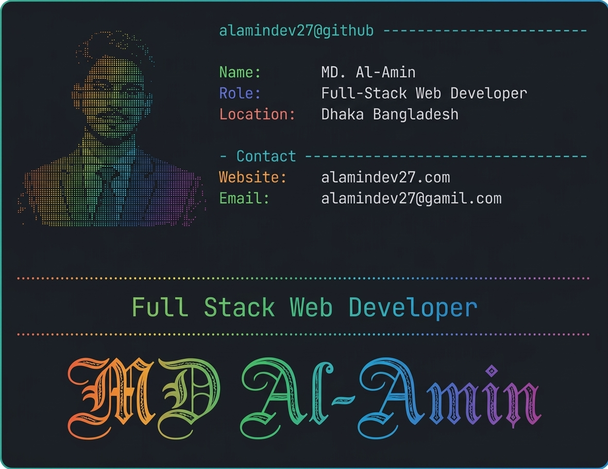


<a href="https://developer.mozilla.org/en-US/docs/Web/CSS">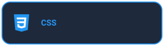</a>

<a href="https://www.php.net/">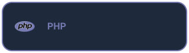</a>

<a href="https://www.docker.com/">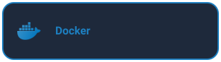</a>

<!-- 
<a href="https://mongoosejs.com/"></a>
 -->


<!-- PROJECTS:START -->

<a href="https://sohojup.com/"></a>

<!-- <a href="https://lucid-alamindev27.vercel.app"></a>
<a href="https://dev-stack-peach-chi.vercel.app"></a>

 -->
<!-- PROJECTS:END -->

<!--  -->

<!--  -->
<!-- <a href="https://www.behance.net/alamindev27"></a> -->
<!--  -->



<picture>
  <source media="(prefers-color-scheme: dark)" srcset="https://raw.githubusercontent.com/alamindev27/alamindev27/output/github-snake-dark.svg" />
  <source media="(prefers-color-scheme: light)" srcset="https://raw.githubusercontent.com/alamindev27/alamindev27/output/github-snake.svg" />
  
</picture>


<!-- BLOG:START -->

<a href="https://alamindev27.blogspot.com/2025/06/e-school-fully-responsive-user-friendly.html"></a>
<a href="https://alamindev27.blogspot.com/2025/06/excited-to-launch-my-3rd-practice.html"></a>
<a href="https://alamindev27.blogspot.com/2025/06/i-just-completed-my-2nd-web-project.html"></a>
<a href="https://alamindev27.blogspot.com/2025/06/i-just-completed-my-first-practice.html"></a>

<!-- BLOG:END -->


---
🔒 **© 2026 MD Al-Amin. All rights reserved.** Unauthorized copying, duplication, or design cloning is strictly prohibited.